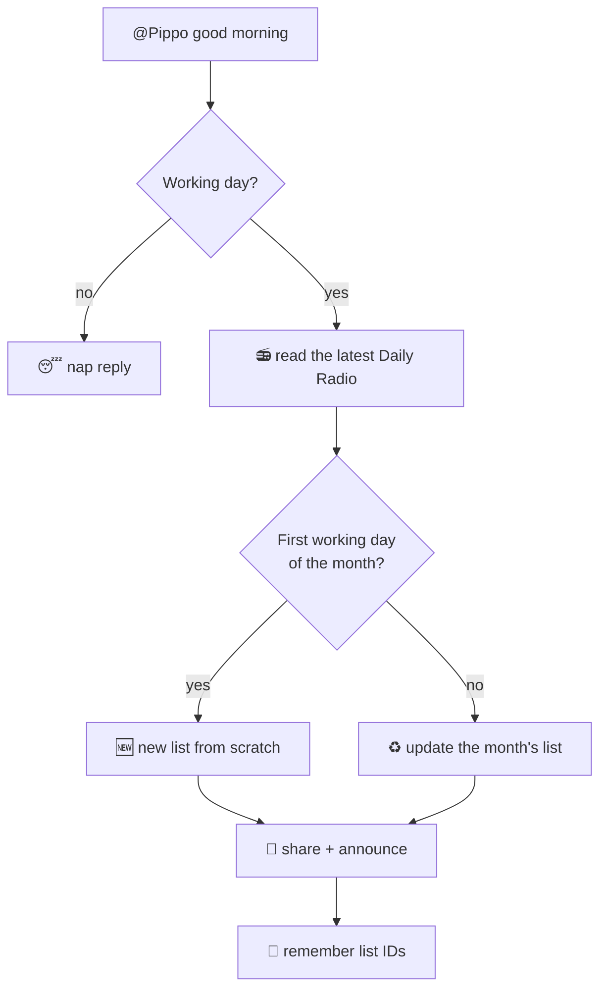

<div align="center">

# 🐥 Pippo

**A tiny Slack duckling that keeps your monthly project list tidy.**

Say *“@Pippo good morning”* and Pippo reads the Daily Radio, builds or updates the month's Slack List, and announces it. Quack.


</div>

---

## ✨ What Pippo does

| You say… | Pippo… |
|---|---|
| 🌅 **“@Pippo good morning”** | reads the latest *Project Status* post, makes or updates this month's list, shares it, and posts the announcement |
| 🔔 **“@Pippo”** (anything else) | taps your team on the shoulder with a cheerful, shuffled reply |
| 😴 **…on a weekend or holiday** | curls up for a nap and does nothing else |

## 🗺️ A day in Pippo's life



## 🚀 Quick start

```bash
pip install -r requirements.txt
python main.py
```

Then, in the app: **Settings** → paste your Slack tokens and channel IDs → **Save** → **Home** → **Wake Pippo up** 🐾

> 📖 Everything is explained inside the app, on the **Guide** page.

## 📦 Make an `.exe` (Windows)

```bat
build_exe.bat
```

Your app lands in `dist\Pippo.exe`. The list template and team list are baked in.

## 🗂️ What's inside

```text
pippo/
├─ main.py                 ▶ start here
├─ build_exe.bat           📦 one-click exe
├─ requirements.txt
├─ data/                   🧩 list template + team list
└─ pippo/
   ├─ core/                🧠 pure rules: calendar, radio parser, statuses, stars, sorting, row planning
   ├─ config/              ⚙️ default settings + where they are saved
   ├─ messaging/           💌 Pippo's built-in messages + the shuffle bag
   ├─ infra/               🔌 Slack gateway + bundled files
   ├─ workflows/           🔁 good morning, new list, daily update, tagging
   ├─ router.py            🚦 decides what each Slack event means
   ├─ engine.py            🏗️ wires everything and runs the Slack connection
   └─ ui/                  🎨 "Pond & Butter" control panel
      ├─ pages/            🏡 home · calendar · settings · guide
      └─ guide_content.py  📖 the in-app manual, as plain data
```

## 🧱 Built on SOLID

| Principle | How it shows up |
|---|---|
| **S**ingle responsibility | one job per module: the Slack gateway only talks to Slack, `core/` never touches I/O, the router only routes |
| **O**pen / closed | new list behaviour = a new `ListStrategy`; new message kind = one entry in `MESSAGE_KINDS`; new page = one class in `PAGES`; new guide topic = one entry in `TOPICS` |
| **L**iskov | `NewListStrategy` and `DailyUpdateStrategy` are interchangeable behind `ListStrategy` |
| **I**nterface segregation | tiny protocols (`ListStrategy`, `Restructurer`) instead of one giant base class |
| **D**ependency inversion | workflows receive their gateway, picker and logger; pages receive an `AppContext` and talk through an event bus |

## 🎨 Design: "Pond & Butter"

Warm paper, a deep pond-ink sidebar, one butter-yellow accent, serif headlines, quiet hairlines, and a duckling drawn in code. Every colour and font lives in `pippo/ui/theme.py`.

## 🔐 Good to know

- Settings (including tokens) are saved in `%APPDATA%\Pippo\config.json` (`~/.pippo` elsewhere). Set `PIPPO_HOME` to move them. Never commit that file.
- `data/slack_user_map.json` and the default IDs in `pippo/config/defaults.py` belong to one workspace. Check them before making the repo public.

---

<div align="center">

made with 💛 for the team · *quack*

</div>
